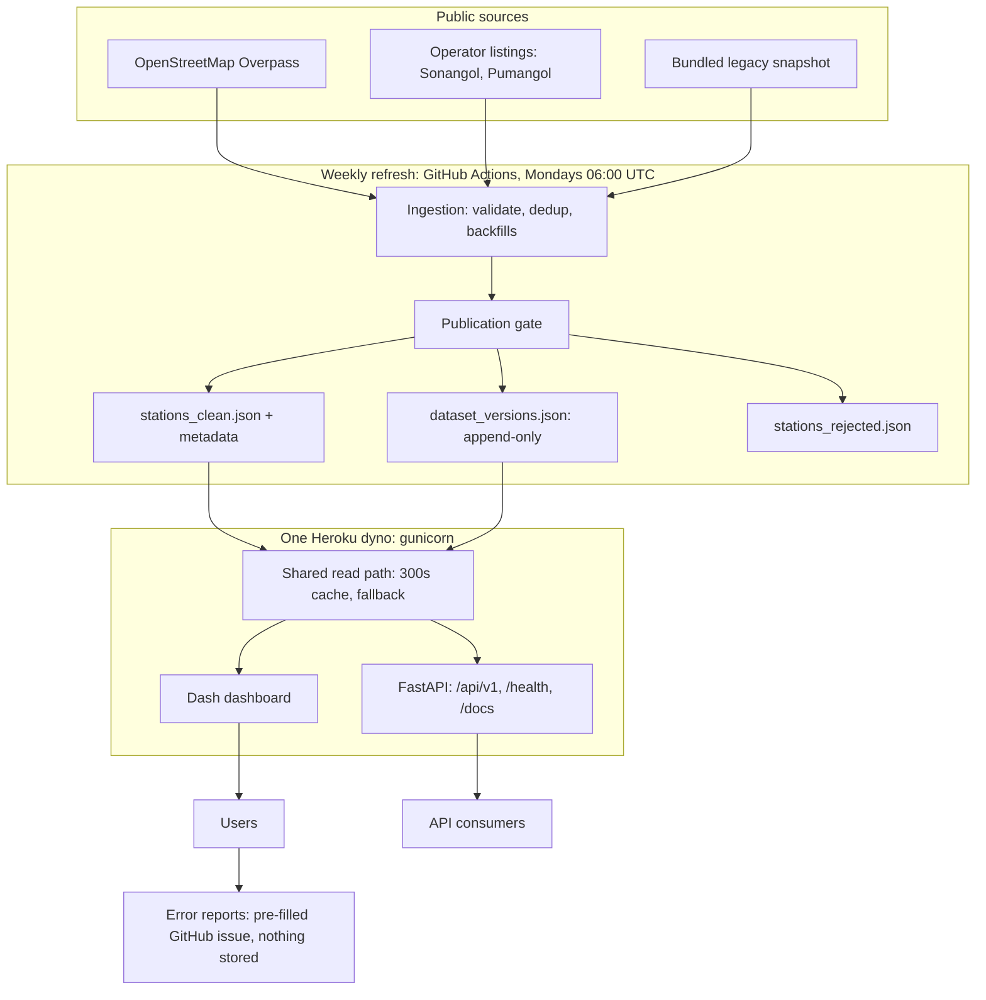

# FuelMap Angola

A Dash application for exploring Angolan fuel stations through a single interactive dashboard. It consumes a public stations API, lets users filter stations by search, brand, province, municipality, and station name, and surfaces live errors when data is unavailable.

## Architecture



One dyno serves the dashboard and the API from the same snapshot, through the same read path. There is no database in the serving path, and error reports are never stored on the server. See `docs/architecture.md` for the full overview.

## Features

- Interactive station explorer with map-first layout.
- Filters for station search, brand, province, municipality, and station.
- Summary cards for total stations, brands, municipalities, and provinces in the current view.
- Stable brand colors on the map legend; filter dropdowns labeled with station counts.
- Clickable map markers with a selected-station detail panel.
- Methodology page at `/metodologia` (in Portuguese): data sources, quality policy, freshness and refresh governance, and what the project is not.
- Error reporting on a dedicated `/reportar-erro` page, reached from a "Reportar erro" button in the selected-station panel: validated in the dashboard, generating a pre-filled GitHub Issue link tied to the dataset version and generation date. Nothing is stored on the server; the report only exists once the user submits the issue.
- Graceful data loading with short request timeouts, in-memory caching, and bundled fallback station data.
- **REST API (FastAPI)** serving the same station dataset as JSON — see below.

## REST API

The station dataset is also served as a JSON REST API: the FastAPI app is mounted into the same WSGI server as the Dash dashboard, so one dyno serves both (see `docs/api-deployment.md`). One service, one source of truth.

| Method | Route | Description |
|---|---|---|
| GET | `/health` | Service health, dataset size and source |
| GET | `/api/v1/stations` | Paginated stations — filters `province`, `operator`, `search`; `page`, `page_size` (max 100) |
| GET | `/api/v1/stations/{id}` | Single station (`id` is stable — deterministic across dataset refreshes) |
| GET | `/api/v1/stations/stats` | Totals by operator and province |
| GET | `/api/v1/stations/provinces` | Distinct provinces |
| GET | `/api/v1/stations/operators` | Distinct operators |
| GET | `/api/v1/meta` | Dataset metadata: generated date, record count, source status and freshness (never an invented date; `unavailable` when metadata is missing) |
| GET | `/api/v1/dataset-versions` | Immutable dataset version registry (`data/dataset_versions.json`), newest last; falls back to the current snapshot when the registry file is missing |

Run it:

```powershell
uvicorn api.main:app --reload
```

Example:

```bash
curl "http://127.0.0.1:8000/api/v1/stations?province=Luanda&page_size=2"
```

```json
{
  "items": [
    {"id": 369, "station": "Viana Km30", "operator": "Pumangol", "province": "Luanda",
     "latitude": -8.964739, "longitude": 13.470033, "...": "..."},
    {"id": 370, "station": "Kilamba Kiaxi", "operator": "Pumangol", "province": "Luanda",
     "latitude": -8.996569, "longitude": 13.289389, "...": "..."}
  ],
  "page": 1, "page_size": 2, "total": 35, "total_pages": 18
}
```

Interactive docs: `http://127.0.0.1:8000/docs`. API tests: `python -m unittest tests.test_api`.

## Project Structure

- `app.py` - Dash app shell and navbar.
- `api/` - FastAPI REST layer (`main.py`, `mount.py`, `routers/stations.py`, `schemas.py`, `db.py`, `deps.py`); `mount.py` mounts the API inside the Dash WSGI app so both are served from one dyno.
- `pages/map.py` - Main station explorer dashboard.
- `data_fetch.py` - Cached, timeout-bound data fetch helper for the API with local fallback data.
- `station_data.py` - Shared normalization: canonical columns, cleaning rules, coordinate validity, stable IDs (used by both the dashboard and the API).
- `ingestion/` - Multi-source station ingestion, normalization, validation, and clean/rejected output generation.
- `docs/architecture.md` - Architecture overview: serving, read path, ingestion, automation, and what the architecture is not.
- `docs/data-ingestion.md` - Data-source strategy and refresh runbook.
- `assets/styles.css` - Dashboard styling.

## Getting Started

1. Create and activate a Python 3.10+ virtual environment.
2. Install dependencies:
   ```powershell
   python -m pip install -r requirements.txt
   ```
3. Run the app locally:
   ```powershell
   python app.py
   ```
4. Open `http://127.0.0.1:8050/`.

## Docker

The same image serves the dashboard and the API, exactly as the `Procfile` does on Heroku:

```bash
docker compose up --build
```

Open `http://127.0.0.1:8050/`. The API is at `/api/v1/stations`, `/health` and `/docs` on the same port.

Run the test suite in a container (exits when done):

```bash
docker compose --profile test up --build test
```

Or build and run the image directly:

```bash
docker build -t fuelmap-angola .
docker run --rm -p 8050:8050 fuelmap-angola
```

Production stays on Heroku (see Deployment below); Docker is the local, reproducible way to run the app and to show the container setup.

## Deployment

- Procfile for Gunicorn: `web: gunicorn app:server`
- Ensure environment variables are set in your host and do not commit secrets.

## Data Source & Resilience

- Stations are loaded from the bundled `data/stations_clean.json` snapshot, rebuilt weekly by the ingestion workflow.
- Reads use a 5 minute in-memory cache.
- If the snapshot is missing or unreadable, the dashboard reuses cached data when available and shows a stale-data warning. If no cache exists yet, it falls back to the legacy bundled `gas_stations.json`.

## Refreshing Station Data

No documented official/public Angola fuel-station API has been identified for government, Sonangol, Pumangol, Galp/Sonangalp, or regulator-style sources. The project therefore uses a multi-source ingestion plan:

- OpenStreetMap Overpass API as the public baseline source for `amenity=fuel` stations in Angola.
- Operator website adapters for brand/operator-owned station listings.
- Operator-specific OSM adapters where an operator does not expose a station-listing page, starting with Sonangol.
- Validation, source health tracking, stale-source reuse, deduplication, and rejected-record output before data reaches the dashboard.

Build only from the bundled legacy JSON:

```powershell
python -m ingestion.sync_stations --offline
```

Build from live sources where network access is available:

```powershell
python -m ingestion.sync_stations
```

See `docs/data-ingestion.md` for the full source strategy, output schema, and runbook.

## CI and Scheduled Data Refresh

- `.github/workflows/ci.yml` runs compile checks, unit tests, and an offline ingestion smoke check on push and pull requests.
- `.github/workflows/refresh-stations.yml` runs weekly and can be triggered manually to refresh live station data and commit changed `data/` outputs.

